<picture>
  <source media="(prefers-color-scheme: dark)" srcset="assets/banner-dark.svg">
  
</picture>

Robotics & AI student at Novosibirsk State University (Institute of Intelligent Robotics, 2023–2027).
I work on computer vision, GPU and parallel computing, robotics (ROS2) and Python backends.

- Thesis (in progress): adaptive UAV route planning based on visual analysis of the underlying terrain
- Also: teaching programming to school students, 3D printing, soldering and building robots

### Selected projects

| Project | What it is | Highlights |
|---|---|---|
| [LBMSim](https://github.com/buklinfur/2D-physics) | 2D Lattice-Boltzmann fluid simulator on CUDA | CUDA–OpenGL interop, real-time rendering at 1920×1080, self-updating binary, release CI on GitHub Actions |
| [StratoSearch](https://github.com/ribus2005/stratosearch) | Seismic data segmentation, hackathon (team) | Designed a custom UNet (anisotropic first block, depthwise-separable convs, ASPP, attention gates): **F1 0.91 vs 0.85 for DPT** |
| [AI secretary](https://github.com/SiberiaField/ai_secretary) | Multi-agent assistant for a university department (team of 2) | ReAct agent on GigaChat without LangChain; my part: async IMAP module, connection manager for concurrent coroutines, task queue |
| [parallelism_theory](https://github.com/buklinfur/parallelism_theory) | Parallel computing course | OpenMP ~22× speedup on 40 threads; heat equation on GPU with OpenACC, cuBLAS, CUDA + CUB, profiled with Nsight |
| [robotics](https://github.com/buklinfur/robotics) | ROS2 course, ~30 exercises | URDF/xacro, Gazebo, RViz, tf2, lidar / IMU / depth camera obstacle stop |
| [DL](https://github.com/buklinfur/DL) | Deep learning labs | Road segmentation **IoU 0.684 / Dice 0.807**; YOLOv8 people detection on aerial images (HERIDAL) |
| [visualize_categorical](https://github.com/buklinfur/DA-3-43) | Python package for categorical data analysis | CLI, encoders, auto-generated reports, tests, **CI matrix 3 OS × 2 Python** |

Team contributions elsewhere: [Emo Radar](https://github.com/buklinfur/slezhka-startup) (stats aggregation, packaging),
[AutoRace 2025](https://github.com/703lovelost/autorace_core_tank/tree/PIDRegSignKonus) (ROS2 sign detection, ShuffleNet classifier),
[RDR](https://github.com/Rualin/RDR/tree/web-src) (React frontend, GitHub Pages deploy).

### Stack

- **Languages:** Python, C++, CUDA C++, SQL, JavaScript
- **ML / CV:** PyTorch, OpenCV, ultralytics (YOLOv8), segmentation_models_pytorch, transformers, ONNX
- **Parallel / GPU:** CUDA, CUB, cuBLAS, OpenACC, OpenMP, asyncio
- **Robotics:** ROS2, Gazebo, RViz, URDF
- **Backend / DevOps:** FastAPI, Flask, PostgreSQL, Docker, nginx, GitHub Actions, Kubernetes (coursework)

### Contact

buklinfur@outlook.com · Telegram [@malfishing](https://t.me/malfishing)
